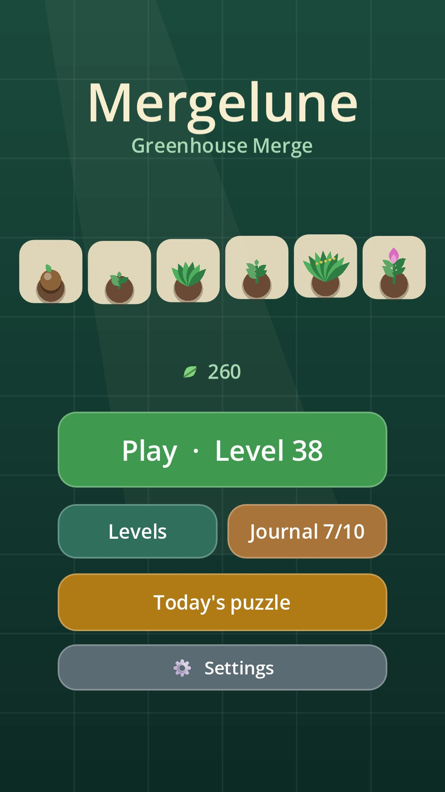
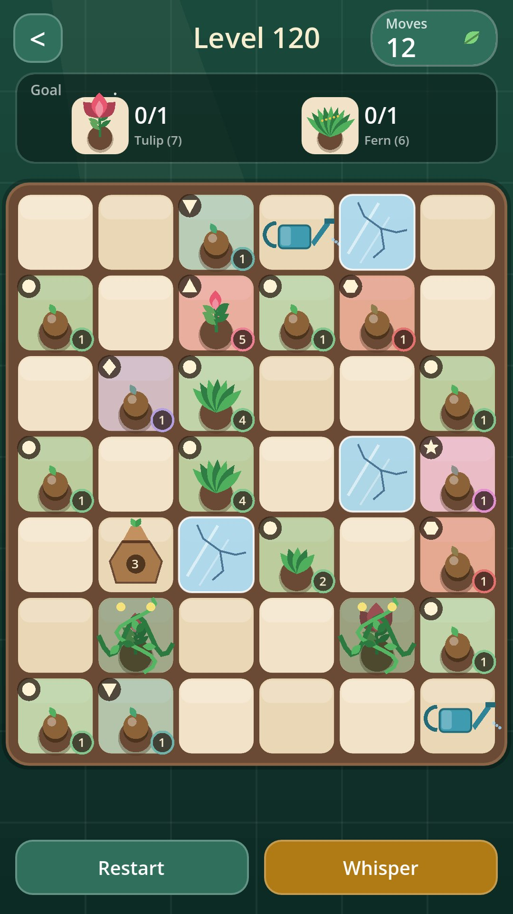
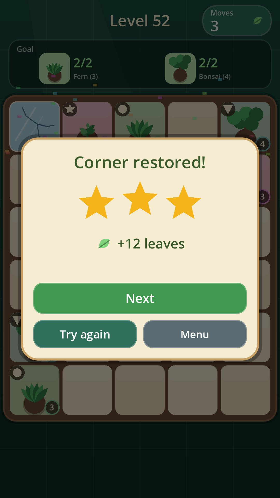
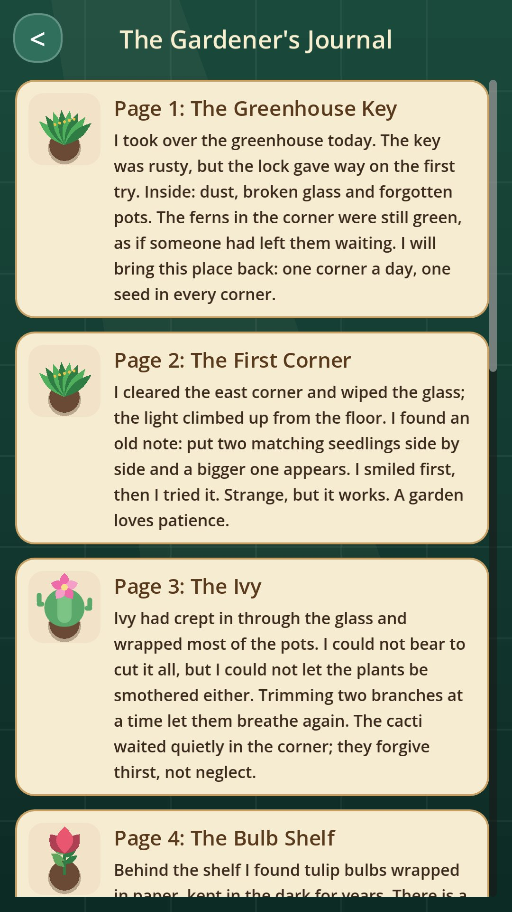

# Mergelune: Garden Merge Puzzle

A calm, offline merge puzzle for Android: drag two matching plants together to grow them — a seed becomes a sprout, a sprout a bud, a bud a flower. Each level asks you to grow certain plants within a limited number of moves, and every level was checked by a solver before release.

[Türkçe](#türkçe) · [Privacy policy](privacy.md)

  
  
  
  

## Download

- **Android:** coming to Google Play.

## Features

- **550 levels** that slowly get harder, with a tougher challenge every 10th level, then an endless mode.
- **8 plant families**: fern, cactus, tulip, lavender, orchid, sunflower, rose and bonsai.
- Glass, vines, seed bags and watering cans that change how you plan. The Whisper shows a good next step when you are stuck.
- A daily puzzle with a streak, 5 garden themes to unlock with leaves, and a garden journal.
- Color-blind friendly: every plant family has its own shape marker.
- English and Turkish. Fully offline.

The game is free. It shows ads from Google AdMob only now and then after you win a level (never while you play, never after a lost level, never in the first 12 levels). When you run out of moves you can choose to watch a rewarded ad for 3 extra moves. A one-time purchase ("Remove ads") turns ads off for good. Intended for ages 13 and over.

## Support

luneapps.support@gmail.com

Built with Godot Engine (MIT license).

This repository holds the documentation only; the source code is not published here.

---

## Türkçe

# Mergelune: Bahçe Birleştirme

Android için sakin, internetsiz bir birleştirme bulmacası: aynı iki bitkiyi sürükleyip birleştir, büyüsünler — tohum filiz olur, filiz tomurcuk, tomurcuk çiçek. Her bölümde belirli bitkileri sınırlı hamlede büyütmen istenir ve her bölüm yayından önce bir çözücüyle denetlendi.

## İndir

- **Android:** Google Play'e geliyor.

## Özellikler

- Yavaş yavaş zorlaşan **550 bölüm**, her 10 bölümde bir daha zorlu bir bölüm, ardından sonsuz mod.
- **8 bitki ailesi**: eğreltiotu, kaktüs, lale, lavanta, orkide, ayçiçeği, gül ve bonsai.
- Planını değiştiren cam, sarmaşık, tohum torbası ve sulama kabı. Takılınca Fısıltı iyi bir sonraki adımı gösterir.
- Seri tutan günlük bulmaca, yaprakla açılan 5 bahçe teması ve bahçe günlüğü.
- Renk körü dostu: her bitki ailesinin kendi şekil işareti var.
- Türkçe ve İngilizce. Tamamen internetsiz çalışır.

Oyun ücretsizdir. Google AdMob reklamlarını yalnızca bir bölümü kazandıktan sonra ara sıra gösterir (oyun sırasında, kaybedilen bölümden sonra ve ilk 12 bölümde asla). Hamlen bitince 3 ek hamle için ödüllü reklam izlemeyi seçebilirsin. Tek seferlik bir satın almayla ("Reklamları kaldır") reklamlar kalıcı olarak kapanır. 13 yaş ve üzeri için tasarlanmıştır.

## Destek

luneapps.support@gmail.com

Godot Engine ile yapıldı (MIT lisansı).

Bu depo yalnızca belgeleri içerir; kaynak kod burada yayımlanmaz.
